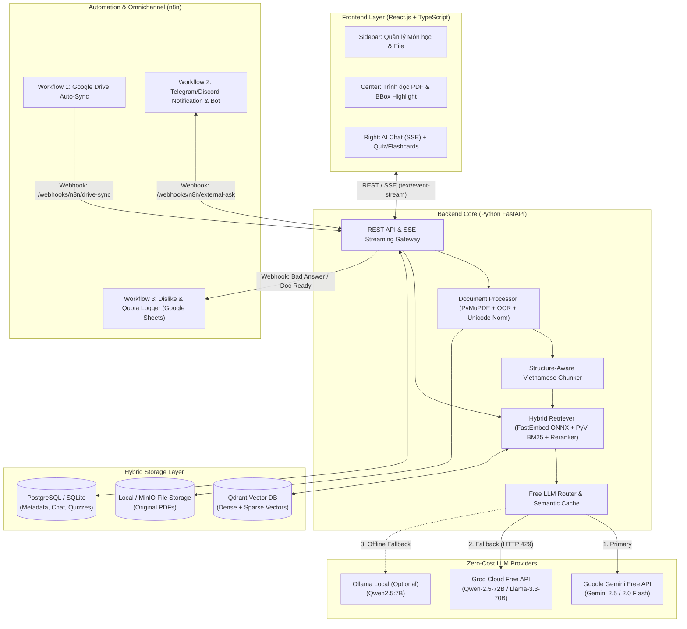
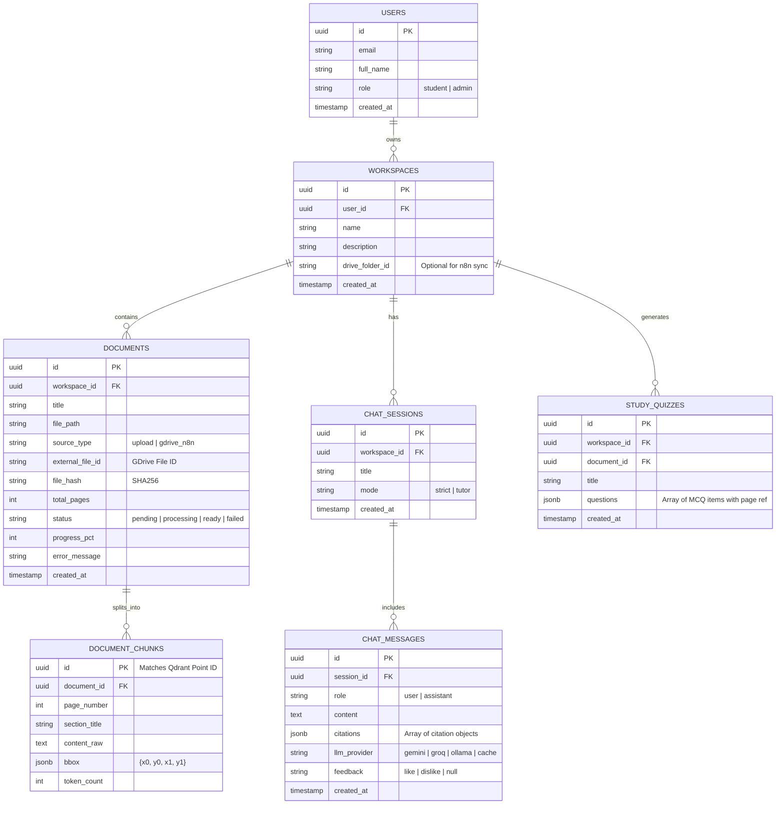
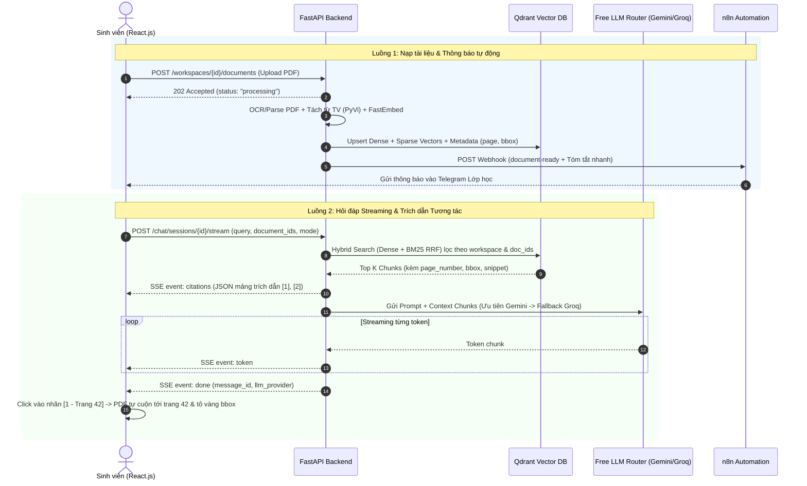

# Product Requirement Document (PRD)
## Hệ Thống Hỏi Đáp & Trợ Lý Học Tập AI Trên Tài Liệu Tiếng Việt (EduRAG-VN)

| Thông tin tài liệu | Chi tiết |
| :--- | :--- |
| **Tên dự án** | **EduRAG-VN** (Hệ thống Hỏi đáp & Ôn tập Tài liệu Học thuật Tiếng Việt) |
| **Phiên bản** | `v1.0.0` |
| **Trạng thái** | Bản thảo khởi tạo (Ready for Review & Implementation) |
| **Kiến trúc cốt lõi** | React.js (Frontend) + Python FastAPI (RAG Backend) + Qdrant (Vector DB) + n8n (Workflow Automation) |
| **Phân khúc mục tiêu** | Giáo dục Đại học / Cao đẳng tại Việt Nam (Sinh viên, Nhóm học tập, Giảng viên) |

---

## 1. Tổng quan & Tầm nhìn Sản phẩm (Executive Summary & Vision)

### 1.1. Bối cảnh & Vấn đề (Problem Statement)
Sinh viên và giảng viên tại các trường Đại học/Cao đẳng Việt Nam phải làm việc với khối lượng lớn tài liệu học thuật đặc thù: giáo trình dài hàng trăm trang (bản PDF chuẩn hoặc bản scan cũ), slide bài giảng rời rạc, đề cương môn học, và tài liệu tham khảo chứa thuật ngữ song ngữ Việt – Anh. 

Các công cụ quốc tế hiện tại (ChatPDF, Google NotebookLM, ChatGPT) hoặc các nền tảng mã nguồn mở mặc định gặp phải **5 rào cản lớn** khi áp dụng vào môi trường học tập tại Việt Nam:
1. **Lỗi trích xuất văn bản tiếng Việt:** File PDF scan mờ/nghiêng hoặc dùng bảng mã cũ (`TCVN3`, `VNI-Windows`) khiến các bộ đọc PDF thông thường bị lỗi font hoàn toàn.
2. **Đứt gãy ngữ nghĩa khi chia nhỏ văn bản (Chunking):** Cắt văn bản theo số ký tự cố định làm đứt đoạn các từ ghép tiếng Việt, cắt ngang định nghĩa, công thức hoặc cấu trúc `Chương – Mục – Tiểu mục`.
3. **Tìm kiếm từ khóa chính xác kém:** Chỉ dùng Vector Embedding (Semantic Search) dẫn đến sai lệch khi sinh viên tra cứu mã môn học, tên định lý, công thức hoặc thuật ngữ chuyên ngành Việt – Anh.
4. **Ảo giác (Hallucination) & Thiếu kiểm chứng trực quan:** Thiếu cơ chế đối chiếu nhanh từ câu trả lời nhảy thẳng đến đúng trang và vị trí đoạn văn trong file PDF gốc để sinh viên kiểm chứng khi ôn thi.
5. **Tài liệu tĩnh, cập nhật thủ công:** Khi giảng viên hoặc lớp trưởng cập nhật bài giảng mới lên Google Drive của lớp, sinh viên phải tải về và upload lại thủ công lên hệ thống AI.

### 1.2. Tầm nhìn Giải pháp (Product Vision)
Xây dựng một nền tảng **Không gian Học tập AI (AI Study Workspace)** lấy cảm hứng từ *Google NotebookLM* và *ChatPDF*, được tối ưu hóa chuyên sâu cho **ngôn ngữ tiếng Việt**, tích hợp **tự động hóa đa kênh với n8n**, và vận hành với **chi phí LLM/Embedding bằng 0 đồng** (kết hợp Local CPU Embedding nhẹ và cơ chế xoay vòng các Cloud LLM API miễn phí).

### 1.3. Mục tiêu & Chỉ số Thành công (Goals & Success Metrics)

| Nhóm chỉ số | Chỉ số đo lường (KPI / Metric) | Mục tiêu (Target) |
| :--- | :--- | :--- |
| **Tốc độ phản hồi** | Thời gian phản hồi token đầu tiên (Time to First Token - TTFT) | `< 2.5 giây` |
| **Chất lượng RAG** | Tỷ lệ câu trả lời có trích dẫn đúng trang tài liệu gốc (Citation Accuracy) | `>= 90%` trên tập câu hỏi kiểm thử |
| **Chống ảo giác** | Tỷ lệ từ chối trả lời đúng khi thông tin không có trong giáo trình (Strict Mode) | `>= 95%` |
| **Tối ưu tài nguyên** | Mức tiêu thụ RAM của Backend FastAPI (nhờ ONNX Runtime / FastEmbed) | `< 1.2 GB RAM` (chạy mượt trên laptop/VPS nhỏ) |
| **Độ sẵn sàng LLM** | Tỷ lệ thành công khi gọi LLM miễn phí (nhờ cơ chế Fallback Gemini <-> Groq) | `>= 99%` (không bị gián đoạn bởi lỗi `HTTP 429`) |

### 1.4. Phạm vi & Giới hạn (Scope & Non-Goals)
* **Trong phạm vi (In-Scope):** Quản lý sổ tay môn học (Workspaces), xử lý PDF chuẩn/scan tiếng Việt & DOCX, Hybrid Search (Dense + BM25 tiếng Việt), Chat SSE Streaming kèm trích dẫn nhảy trang PDF, tạo Quiz trắc nghiệm & Flashcard ôn thi, tự động hóa đồng bộ Google Drive & thông báo/hỏi đáp Telegram qua n8n.
* **Ngoài phạm vi giai đoạn đầu (Out-of-Scope / Non-Goals):** Chưa xây dựng ứng dụng di động native (iOS/Android), chưa tự huấn luyện (fine-tune) mô hình LLM riêng trên GPU đắt tiền, chưa tích hợp cổng thanh toán thương mại.

---

## 2. Chân dung Người dùng (User Personas)

| Chân dung | Vai trò | Nhu cầu cốt lõi (Goals) | Điểm đau hiện tại (Frustrations) |
| :--- | :--- | :--- | :--- |
| **1. Sinh viên Đại học (Primary User)** | Người học cá nhân | - Gom toàn bộ slide, giáo trình, đề cương của từng môn vào một nơi.<br>- Hỏi nhanh khái niệm, công thức và biết chính xác nó nằm ở trang nào.<br>- Tự tạo đề trắc nghiệm (MCQ) và Flashcard để tự kiểm tra trước kỳ thi. | - Đọc giáo trình 400 trang không kịp trước ngày thi.<br>- Sợ AI trả lời "bịa" khác với định nghĩa trong slide của giảng viên. |
| **2. Lớp trưởng / Nhóm học tập (Collaborative User)** | Quản lý kho tài liệu lớp | - Kết nối thư mục Google Drive chung của lớp với hệ thống.<br>- Khi thầy cô gửi slide mới lên Drive, cả lớp nhận được thông báo và hỏi bài được ngay trên Web hoặc nhóm Telegram. | - Phải tải từng file mới gửi cho các bạn hoặc upload lại từ đầu. |
| **3. Giảng viên / Trợ giảng (Content Admin)** | Cố vấn học thuật | - Đưa đề cương (Syllabus) và tài liệu chuẩn lên hệ thống.<br>- Xem thống kê các câu hỏi sinh viên hay hỏi hoặc câu trả lời bị đánh giá sai (`Dislike`) để giải đáp. | - Phải trả lời lặp đi lặp lại các câu hỏi hành chính môn học (*"Thi hình thức gì?", "Chương 3 học phần nào?"*). |
| **4. Quản trị viên Hệ thống (System / n8n Admin)** | Vận hành kỹ thuật | - Giám sát luồng đồng bộ n8n, quản lý danh sách API Key miễn phí (Gemini/Groq), theo dõi log lỗi qua Google Sheets/Telegram. | - API miễn phí dễ bị chạm giới hạn RPM (Rate Limit) nếu không có bộ điều phối. |

---

## 3. Kiến trúc Hệ thống & Lựa chọn Công nghệ (System Architecture & Tech Stack)

### 3.1. Sơ đồ Kiến trúc Tổng thể



### 3.2. Bảng Công nghệ Chi tiết (Chi phí Vận hành 0 Đồng)

| Phân hệ | Công nghệ lựa chọn | Lý do kỹ thuật & Tối ưu hóa |
| :--- | :--- | :--- |
| **Frontend** | **React.js (Vite + TypeScript)**, Tailwind CSS, `shadcn/ui`, `react-resizable-panels`, `react-pdf` | Tốc độ dựng nhanh, hỗ trợ kéo giãn 3 cột linh hoạt như NotebookLM và tô sáng tọa độ trích dẫn trên trang PDF. |
| **Backend API** | **Python 3.11+ & FastAPI**, `SQLAlchemy` (Async), `Pydantic v2` | Hiệu năng bất đồng bộ (async/await) cao, hỗ trợ tốt `Server-Sent Events (SSE)` và `BackgroundTasks`. |
| **Xử lý Tài liệu TV** | `PyMuPDF (fitz)`, `python-docx`, `VietOCR` / `Tesseract OCR`, Bộ chuyển mã `TCVN3/VNI -> Unicode` | Trích xuất văn bản kèm tọa độ (`bounding box`), giữ nguyên số trang và xử lý tốt cả giáo trình scan. |
| **Embedding & BM25** | `FastEmbed` (`intfloat/multilingual-e5-small` hoặc `BAAI/bge-m3` chạy ONNX CPU) + `pyvi` (tách từ tiếng Việt cho BM25) | Chạy 100% trên CPU máy chủ mà không cần GPU, chỉ tốn ~500MB RAM, bắt chuẩn cả ngữ nghĩa lẫn từ khóa chuyên ngành Việt - Anh. |
| **Vector & Relational DB** | **Qdrant** (Docker) + **PostgreSQL** (hoặc SQLite cho môi trường dev nhẹ) | Qdrant hỗ trợ sẵn Hybrid Search (kết hợp Dense Vector và Sparse BM25 Vector trong 1 truy vấn) với bộ lọc metadata siêu tốc. |
| **LLM Orchestration** | **Google Gemini API (Free)** + **Groq Cloud API (Free)** + Bộ xoay vòng Key (Key Rotation) | Đảm bảo chi phí 0đ, phản hồi cực nhanh (~300 tokens/s trên Groq) và không bao giờ bị gián đoạn khi 1 nhà cung cấp hết quota phút. |
| **Workflow Automation** | **n8n** (Self-hosted qua Docker) | Kết nối không cần code với Google Drive, Telegram, Discord, Google Sheets để tự động hóa luồng dữ liệu và giám sát chất lượng. |

---

## 4. Đặc tả Yêu cầu Chức năng (Functional Requirements)

Các tính năng được phân loại theo độ ưu tiên:
* **P0 (Must-Have / MVP):** Cốt lõi bắt buộc phải có để hệ thống hoạt động trọn vẹn.
* **P1 (Should-Have):** Tính năng tạo lợi thế cạnh tranh cho ngách Giáo dục/Sinh viên và tích hợp n8n.
* **P2 (Nice-to-Have):** Tính năng mở rộng nâng cao trải nghiệm.

### 4.1. Phân hệ 1: Quản lý Không gian Môn học & Tài liệu (Workspace & Document Management)

| Mã FR | Tên tính năng | Độ ưu tiên | Mô tả chi tiết & Tiêu chí nghiệm thu (Acceptance Criteria) |
| :--- | :--- | :---: | :--- |
| **FR-WS-01** | Quản lý Sổ tay Môn học (Subject Workspaces) | **P0** | - Người dùng có thể Tạo, Xem danh sách, Đổi tên, Xóa các không gian môn học (VD: *"Kinh tế vĩ mô"*, *"Mạng máy tính"*).<br>- Mỗi Workspace có thể gắn kèm `drive_folder_id` (tùy chọn) để phục vụ đồng bộ tự động qua n8n. |
| **FR-DOC-01** | Tải lên đa định dạng & Kiểm soát trùng lặp | **P0** | - Hỗ trợ tải lên `.pdf`, `.docx`, `.txt` (tối đa 50MB/file).<br>- Tự động băm `SHA-256` nội dung file: nếu file đã tồn tại trong cùng Workspace, cảnh báo hoặc bỏ qua bước băm vector lại để tiết kiệm tài nguyên. |
| **FR-DOC-02** | Xử lý ngầm & Theo dõi tiến độ thời gian thực | **P0** | - Khi upload, API trả về ngay trạng thái `pending`/`processing` và chạy ngầm (`BackgroundTasks`).<br>- Giao diện React hiển thị thanh tiến trình theo từng bước: *Đang đọc PDF -> Đang chuẩn hóa tiếng Việt -> Đang tạo Vector (trang X/Y) -> Hoàn tất (`ready`)*. |
| **FR-DOC-03** | Xóa tài liệu đồng bộ (Cascade Delete) | **P0** | - Khi xóa 1 tài liệu khỏi Workspace, hệ thống xóa file gốc, xóa bản ghi SQL và **xóa toàn bộ các vector chunks** có `document_id` tương ứng trong Qdrant. |

### 4.2. Phân hệ 2: Pipeline Xử lý Tài liệu Tiếng Việt & Hybrid Indexing (RAG Core)

| Mã FR | Tên tính năng | Độ ưu tiên | Mô tả chi tiết & Tiêu chí nghiệm thu (Acceptance Criteria) |
| :--- | :--- | :---: | :--- |
| **FR-RAG-01** | Chuẩn hóa Tiếng Việt & OCR thông minh | **P0** | - Tự động chuẩn hóa bảng mã Unicode dựng sẵn (`NFC`) và chuyển đổi văn bản từ bảng mã cũ (`VNI`, `TCVN3`) nếu phát hiện.<br>- Tự động kiểm tra mật độ chữ trên từng trang PDF: nếu trang PDF là ảnh scan (không có text layer), tự động kích hoạt OCR tiếng Việt cho trang đó. |
| **FR-RAG-02** | Chia nhỏ văn bản theo cấu trúc (Structure-Aware Chunking) | **P0** | - Không cắt ngang câu hoặc cắt đứt bảng biểu.<br>- Nhận diện các tiêu đề học thuật (`Chương`, `Mục 1.1`, `Bài`, `Slide #`) để lưu vào trường metadata `section_title`.<br>- Lưu kèm số trang (`page_number`) và tọa độ khối văn bản (`bbox: {x0, y0, x1, y1}`) trên trang PDF. |
| **FR-RAG-03** | Tìm kiếm Lai (Hybrid Search: Dense + Sparse BM25) | **P0** | - Khi nhận câu hỏi, hệ thống tách từ tiếng Việt bằng `pyvi` (VD: `"hợp_đồng lao_động"`, `"cấu_trúc dữ_liệu"`) để tạo Sparse Vector BM25, đồng thời tạo Dense Vector bằng `FastEmbed`.<br>- Truy vấn Qdrant bằng phương pháp kết hợp (`Reciprocal Rank Fusion - RRF`) có lọc cứng theo `workspace_id` và danh sách `document_ids` mà sinh viên đang tích chọn. |
| **FR-RAG-04** | Chấm điểm lại (Reranking) & Ngưỡng chống ảo giác | **P1** | - Sắp xếp lại Top 10 đoạn văn tìm được xuống còn Top 4–5 đoạn có độ liên quan cao nhất.<br>- Nếu tất cả các đoạn đều có điểm tương đồng thấp hơn ngưỡng (`score < threshold`), hệ thống trả lời rõ: *"Không tìm thấy thông tin này trong tài liệu môn học của bạn"* thay vì tự suy diễn. |

### 4.3. Phân hệ 3: Hỏi đáp AI Đa chế độ & Trích dẫn Tương tác (Interactive Chat & Citations)

| Mã FR | Tên tính năng | Độ ưu tiên | Mô tả chi tiết & Tiêu chí nghiệm thu (Acceptance Criteria) |
| :--- | :--- | :---: | :--- |
| **FR-CHAT-01** | Hỏi đáp Streaming qua SSE kèm Trích dẫn tức thì | **P0** | - Sử dụng giao thức `Server-Sent Events (SSE)` trả về sự kiện `citations` trước tiên, tiếp theo là từng `token` văn bản.<br>- Trong câu trả lời bắt buộc gắn các chỉ mục trích dẫn dạng `[1]`, `[2]`. |
| **FR-CHAT-02** | Click-to-Highlight (Nhảy trang & Tô sáng PDF) | **P0** | - Khi sinh viên bấm vào thẻ trích dẫn `[1 - Trang 14]` trong khung Chat, khung đọc PDF ở giữa tự động mở đúng tài liệu, cuộn mượt tới **Trang 14** và tô màu nổi bật (highlight) đoạn văn bản gốc dựa vào `bbox` hoặc `snippet`. |
| **FR-CHAT-03** | Chế độ Học thuật Kép (Strict Mode vs. Tutor Mode) | **P1** | - **Chế độ Bám sát giáo trình (`Strict Mode`):** Chỉ dùng 100% thông tin trong tài liệu để ôn thi chuẩn theo ý giảng viên.<br>- **Chế độ Gia sư (`Tutor Mode`):** Dựa trên định nghĩa trong giáo trình nhưng cho phép AI giải thích dễ hiểu hơn và lấy thêm ví dụ thực tế bên ngoài (tách biệt rõ hộp *"Kiến thức trong tài liệu"* và *"Giải thích mở rộng"*). |
| **FR-CHAT-04** | Bộ lọc Phạm vi Tài liệu (Context Scope Selector) | **P0** | - Ở cột bên trái, sinh viên có thể tích chọn (checkbox) 1 file, một vài file, hoặc toàn bộ file trong môn học để giới hạn phạm vi tìm kiếm của câu hỏi tiếp theo. |
| **FR-CHAT-05** | Đánh giá chất lượng câu trả lời (Like / Dislike Feedback) | **P1** | - Sinh viên có thể bấm `Like` hoặc `Dislike` (kèm lý do: *Sai kiến thức, Sai số trang, Thiếu ý*) trên từng câu trả lời để kích hoạt cảnh báo qua n8n. |

### 4.4. Phân hệ 4: Công cụ Ôn thi Thông minh cho Sinh viên (Study Tools)

| Mã FR | Tên tính năng | Độ ưu tiên | Mô tả chi tiết & Tiêu chí nghiệm thu (Acceptance Criteria) |
| :--- | :--- | :---: | :--- |
| **FR-STD-01** | Tạo đề Trắc nghiệm Ôn tập (Quiz MCQ Generator) | **P1** | - Sinh viên chọn tài liệu hoặc nhập chủ đề/chương (VD: *"Chương 2: Cung - Cầu"*) và số lượng câu hỏi (5, 10, 15 câu).<br>- Hệ thống sinh bộ câu hỏi trắc nghiệm 4 đáp án A/B/C/D ở định dạng JSON chuẩn.<br>- Giao diện React cho phép làm bài trực tiếp, chấm điểm, hiển thị giải thích chi tiết và nút bấm mở trang PDF chứa đáp án. |
| **FR-STD-02** | Tạo thẻ Ghi nhớ (Flashcards Generator) | **P2** | - Tự động rút trích các cặp `Thuật ngữ / Công thức (Mặt trước)` – `Định nghĩa ngắn gọn + Số trang (Mặt sau)` từ tài liệu để sinh viên lật thẻ ôn bài nhanh. |

### 4.5. Phân hệ 5: Luồng Tự động hóa & Đa kênh (n8n Workflows)

| Mã FR | Tên tính năng | Độ ưu tiên | Mô tả chi tiết & Tiêu chí nghiệm thu (Acceptance Criteria) |
| :--- | :--- | :---: | :--- |
| **FR-N8N-01** | Tự động đồng bộ thư mục Google Drive của lớp | **P1** | - Khi có file mới hoặc file cập nhật trong Google Drive Folder của môn học, n8n tự động tải file và gọi webhook `/api/v1/webhooks/n8n/drive-sync` của FastAPI để nạp/cập nhật vector mà không cần upload tay. |
| **FR-N8N-02** | Thông báo bài giảng mới kèm Tóm tắt tự động | **P1** | - Sau khi FastAPI xử lý xong tài liệu mới, hệ thống bắn sự kiện sang n8n để gửi thông báo vào nhóm **Telegram / Discord** của lớp kèm 5 gạch đầu dòng tóm tắt nội dung chính của tài liệu vừa tải lên. |
| **FR-N8N-03** | Hỏi đáp nhanh qua Telegram Bot của lớp | **P2** | - Sinh viên có thể gõ lệnh `/ask <câu hỏi>` trên nhóm Telegram lớp -> n8n chuyển tiếp câu hỏi vào FastAPI -> trả lời kèm tên file và số trang ngay trong nhóm chat. |
| **FR-N8N-04** | Ghi nhận Báo cáo Câu trả lời sai & Cảnh báo Quota | **P1** | - Khi sinh viên bấm `Dislike` hoặc khi hệ thống gặp lỗi Rate Limit trên các API Key, FastAPI bắn webhook sang n8n để tự động ghi dòng log vào **Google Sheets** và nhắn tin cảnh báo cho Admin. |

---

## 5. Thiết kế Giao diện & Trải nghiệm Người dùng (UI/UX Specification)

Giao diện Web được thiết kế theo mô hình **3-Column Resizable Workspace** (Không gian làm việc 3 cột có thể kéo giãn kích thước), tối ưu cho màn hình Desktop/Laptop của sinh viên:

```
+--------------------------------------------------------------------------------------------------+
| [Logo] EduRAG-VN   | Môn học: [ Kinh tế vĩ mô v ]          | Chế độ: (•) Bám sát  ( ) Gia sư     |
+--------------------+---------------------------------------+-------------------------------------+
| 1. NGUỒN TÀI LIỆU  | 2. TRÌNH ĐỌC TÀI LIỆU (PDF VIEWER)    | 3. TRỢ LÝ AI & CÔNG CỤ ÔN TẬP       |
| (Collapsible 20%)  | (Resizable Center Panel ~45%)         | (Resizable Right Panel ~35%)        |
+--------------------+---------------------------------------+-------------------------------------+
| [+ Tải tài liệu]   | [Giao_trinh_KTVM.pdf]  Trang [42]/310 | [Tab: Hỏi đáp AI] [Tab: Trắc nghiệm]|
| [GDrive: Đã kết nối| ------------------------------------- | ----------------------------------- |
|                    | Chương 3: LẠM PHÁT VÀ THẤT NGHIỆP     | SV: Phân biệt lạm phát cầu kéo và   |
| [x] Chọn tất cả (3)|                                       |     lạm phát chi phí đẩy?           |
|                    | 3.1. Khái niệm lạm phát               |                                     |
| [x] Giao_trinh.pdf | ...                                   | AI: Dựa trên giáo trình của bạn:    |
|     (Ready - 310p) | +-----------------------------------+ | - **Lạm phát cầu kéo**: Xảy ra khi  |
|                    | | [HIGHLIGHT VÀNG]: Lạm phát do cầu | |   tổng cầu tăng nhanh hơn tổng cung |
| [x] Slide_Ch3.pdf  | | kéo xảy ra khi tổng cầu tăng...   | |   [1: Giao_trinh - Tr.42].          |
|     (Ready - 28p)  | +-----------------------------------+ | - **Lạm phát chi phí đẩy**: Do chi  |
|                    |                                       |   phí sản xuất tăng [2: Slide - Tr.8|
| [ ] De_cuong.docx  |                                       |                                     |
|     (Ready - 5p)   |                                       | [👍 Hữu ích] [👎 Báo sai] [Tạo Quiz]|
|                    |                                       | ----------------------------------- |
|                    |                                       | [ Nhập câu hỏi cho các file đã chọn]|
+--------------------+---------------------------------------+-------------------------------------+
```

### Các nguyên tắc UX cốt lõi:
1. **Zero-Friction Verification (Kiểm chứng không độ trễ):** Mọi con số trích dẫn `[1: Tên_file - Tr.42]` là một nút bấm tương tác (Badge). Bấm vào là cột giữa tự động chuyển tới đúng file, cuộn đến trang 42 và nhấp nháy khung màu vàng tại đoạn văn bản gốc.
2. **Transparent AI State (Minh bạch trạng thái xử lý):** Khi sinh viên gửi câu hỏi, hiển thị rõ bước hiện tại: *"Đang tìm trong 2 tài liệu..."* -> *"Đã tìm thấy 4 đoạn trích dẫn liên quan"* -> *"Đang viết câu trả lời..."*.
3. **Mobile/Tablet Responsive:** Trên màn hình nhỏ (`< 1024px`), chuyển từ bố cục 3 cột sang dạng **Tabs chuyển đổi** (*Tài liệu* | *Xem PDF* | *Hỏi đáp*) kèm Bottom Sheet hiển thị nhanh đoạn trích dẫn.

---

## 6. Thiết kế Dữ liệu & Đặc tả Giao tiếp API (Data Model & API Contracts)

### 6.1. Sơ đồ Thực thể Liên kết (ERD - Relational Database)



### 6.2. Danh mục API Endpoints Cốt lõi (`/api/v1`)

| Phân nhóm | Method & Endpoint | Mô tả |
| :--- | :--- | :--- |
| **Workspaces** | `GET /api/v1/workspaces` | Lấy danh sách sổ tay môn học kèm số lượng tài liệu. |
| | `POST /api/v1/workspaces` | Tạo sổ tay môn học mới. |
| | `DELETE /api/v1/workspaces/{ws_id}` | Xóa sổ tay môn học và toàn bộ dữ liệu liên quan. |
| **Documents** | `POST /api/v1/workspaces/{ws_id}/documents` | Upload file mới, kích hoạt pipeline xử lý ngầm. |
| | `GET /api/v1/documents/{doc_id}/status` | Kiểm tra tiến độ băm tài liệu (`progress_pct`, `status`). |
| | `GET /api/v1/documents/{doc_id}/file` | Stream file PDF gốc để render lên trình đọc React. |
| | `DELETE /api/v1/documents/{doc_id}` | Xóa tài liệu khỏi SQL và Qdrant. |
| **RAG Chat** | `POST /api/v1/chat/sessions` | Tạo phiên hội thoại mới trong môn học. |
| | `GET /api/v1/chat/sessions/{session_id}/messages` | Lấy lịch sử tin nhắn kèm metadata trích dẫn. |
| | `POST /api/v1/chat/sessions/{session_id}/stream` | Gửi câu hỏi và nhận luồng SSE (`event: citations` -> `event: token` -> `event: done`). |
| | `PATCH /api/v1/chat/messages/{msg_id}/feedback` | Gửi đánh giá `like`/`dislike` (bắn webhook sang n8n nếu `dislike`). |
| **Study Tools** | `POST /api/v1/study/quiz/generate` | Sinh bộ câu hỏi trắc nghiệm MCQ có trích dẫn trang. |
| | `POST /api/v1/study/flashcards/generate` | Sinh bộ thẻ ghi nhớ thuật ngữ (Flashcards). |
| **n8n Webhooks**| `POST /api/v1/webhooks/n8n/drive-sync` | Nhận file mới/cập nhật từ Google Drive qua n8n. |
| | `POST /api/v1/webhooks/n8n/external-ask` | API trả lời câu hỏi từ Telegram/Discord Bot qua n8n. |

### 6.3. Biểu đồ Tuần tự Luồng Hỏi Đáp & Tự Động Hóa (Sequence Diagram)



---

## 7. Yêu cầu Phi chức năng (Non-Functional Requirements)

1. **Khả năng Chống nghẽn Rate Limit (Zero-Cost LLM Resilience):**
   * Bộ `LLMRouter` trong FastAPI phải hỗ trợ danh sách nhiều API Key (`GEMINI_API_KEYS`, `GROQ_API_KEYS`) theo cơ chế *Round-Robin* và *Automatic Failover*: Khi gặp mã lỗi `429 Too Many Requests` hoặc timeout quá 8 giây ở nhà cung cấp chính, tự động chuyển sang nhà cung cấp dự phòng trong vòng `< 200ms` mà người dùng cuối không nhận thấy lỗi.
   * Tích hợp **Semantic Cache**: Lưu cache các cặp `(workspace_id, normalized_query, document_ids_hash)` trong bộ nhớ/SQLite để trả lời tức thì các câu hỏi trùng lặp trong lớp học mà không tốn quota LLM.
2. **Độ chính xác Xử lý Tiếng Việt:**
   * Đảm bảo tách từ tiếng Việt chính xác bằng `pyvi` cho chỉ mục từ khóa (Sparse BM25) để bắt trúng 100% các mã môn học, số hiệu công thức hoặc tên riêng.
3. **Bảo mật & Cô lập Dữ liệu (Data Isolation):**
   * Mọi truy vấn vào Qdrant bắt buộc phải đính kèm `Filter(must=[FieldCondition(key="workspace_id", match=MatchValue(value=ws_id))])` để tuyệt đối không xảy ra hiện tượng rò rỉ ngữ cảnh giữa các môn học hoặc giữa các người dùng khác nhau.
   * Các endpoint giao tiếp với n8n phải được bảo vệ bởi Header `X-N8N-API-Key`.

---

## 8. Lộ trình Triển khai (Implementation Roadmap)

Để xây dựng hệ thống bài bản, dự án được chia làm **4 giai đoạn (Phases)** tuần tự:

| Giai đoạn | Mục tiêu trọng tâm | Các hạng mục bàn giao (Deliverables) |
| :--- | :--- | :--- |
| **Phase 1: Khởi tạo Nền tảng & Core Backend** | Dựng khung dự án, Database & Pipeline đọc PDF tiếng Việt | - Khởi tạo cấu trúc thư mục Monorepo (`backend/`, `frontend/`, `n8n/`, `docker-compose.yml`).<br>- Thiết lập Database Models (SQLAlchemy) & Qdrant Client.<br>- Xây dựng bộ đọc PDF (`PyMuPDF`), chuẩn hóa Unicode tiếng Việt và Structure-Aware Chunker lưu kèm `page_number` & `bbox`. |
| **Phase 2: Hybrid RAG Engine & Free LLM Router** | Hoàn thiện bộ não tìm kiếm & hỏi đáp SSE | - Tích hợp `FastEmbed` (ONNX CPU) + `pyvi` BM25 vào Qdrant.<br>- Xây dựng `LLMRouter` xoay vòng Gemini Free <-> Groq Free.<br>- Hoàn thiện API `/chat/sessions/{id}/stream` (SSE) kèm trích dẫn và API tạo Quiz trắc nghiệm (`/study/quiz/generate`). |
| **Phase 3: Giao diện Học tập 3 Cột (React.js Frontend)** | Xây dựng trải nghiệm NotebookLM + ChatPDF | - Dựng giao diện 3 cột kéo giãn (`react-resizable-panels`).<br>- Tích hợp trình đọc PDF (`react-pdf`) có khả năng nhảy trang và tô sáng đoạn văn bản khi click vào trích dẫn `[1]`.<br>- Xây dựng màn hình làm bài Quiz trắc nghiệm & Flashcard tương tác. |
| **Phase 4: Tích hợp n8n Workflows & Kiểm thử** | Tự động hóa đa kênh & Đóng gói toàn hệ thống | - Xây dựng các file cấu hình workflow mẫu cho **n8n** (Google Drive Sync, Telegram Notification/Bot, Dislike Logger).<br>- Kiểm thử toàn diện (End-to-End) với bộ giáo trình tiếng Việt thực tế. |
